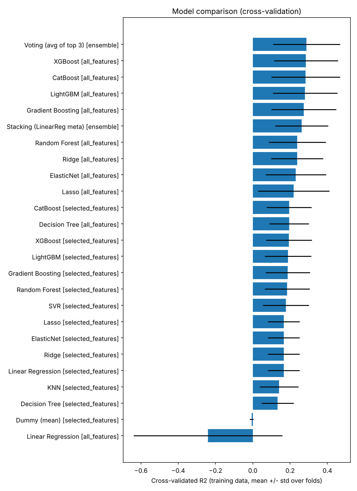
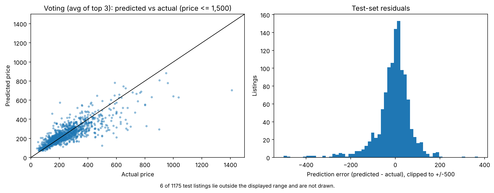
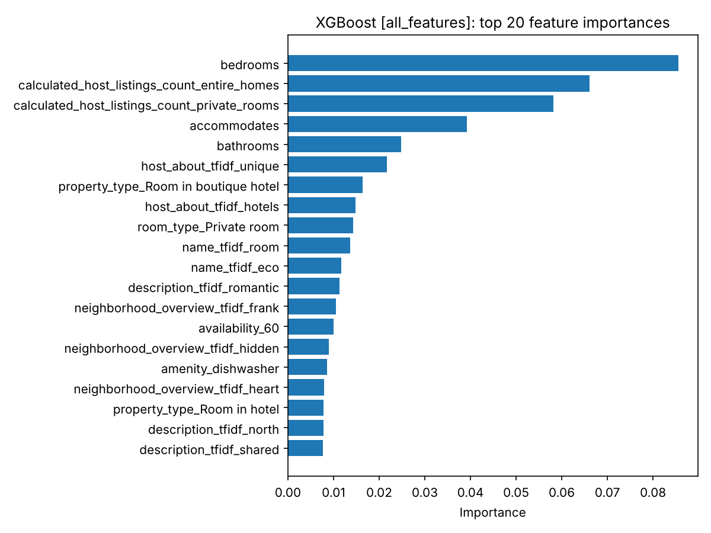

# Airbnb Amsterdam – Nightly Price Prediction

Regression pipeline that predicts the nightly price of Amsterdam Airbnb listings from the
[Inside Airbnb](https://insideairbnb.com/get-the-data/) listings snapshot. The project covers leakage-safe
preprocessing, automatic feature selection, cross-validated model selection across 12 regression models and two ensembles,
and an honest held-out evaluation.

> **Headline result.** The model selected by cross-validation (Voting (avg of top 3), ensemble) reaches
> R² = 0.284 (MAE 60.3, RMSE 204.5) on the 1173 test listings priced below 30,000,
> against R² ≈ 0 for a constant-mean baseline. On the full test set every model scores between -0.06 and 0.001 R² because two listings priced
> at 80,018 dominate the squared error (see [Evaluation notes](#evaluation-notes)). Price in this dataset is only moderately predictable from listing attributes.

## Data

- Source: Inside Airbnb, Amsterdam, `listings.csv.gz` (detailed listings, scraped 2025-09-11).
- The dataset is **not included** in this repository. Download it from <https://insideairbnb.com/get-the-data/> and save it as `data/listings.csv.gz`.
- After removing rows without a target price, 5874 listings remain, split 80/20 (`random_state=42`) into 4,699 training and 1,175 test rows **before** any learned preprocessing.

## Project structure

```
airbnb-price-prediction/
├── data/                         # put listings.csv.gz here (git-ignored)
├── notebooks/
│   ├── 01_preprocessing.ipynb    # cleaning, encoding, TF-IDF, feature selection
│   └── 02_regression_models.ipynb# model selection (CV) and final evaluation
├── processed/                    # generated: parquet tables, selected_features.json (git-ignored)
├── results/                      # generated: CV/test result tables, best parameters
├── images/                       # generated figures
├── requirements.txt
└── README.md
```

## Pipeline

### 1. Preprocessing (`01_preprocessing.ipynb`)

- Train/test split first; every learned quantity (imputation medians, rare-category lists, amenity thresholds, TF-IDF vocabularies, one-hot category levels) is fitted on the training split only and applied unchanged to the test split.
- Missing-value indicators, cleaned numeric strings, engineered features (host experience, licence status, amenity flags, review/host-picture indicators) and TF-IDF features for four text columns (2,000 columns).
- One-hot encoding uses the category levels of the training data, so train and test have identical columns in identical order (asserted before saving).
- **Excluded from all predictors:** `id`, `host_id` (identifiers) and `estimated_revenue_l365d` (computed from the target price, i.e. leakage).

### 2. Automatic feature selection

A multi-criteria report is computed on the **training split only** for the 268 non-text candidate features: Pearson/Spearman correlation with FDR-corrected significance, mutual information, f-regression, feature-feature correlation, VIF, random-forest importance and permutation importance.
The recommendations were: Remove: 118, Requires further investigation: 82, Redundant: 28, Strong candidate: 22, Candidate: 13, Weak candidate: 5.
Features labelled *Strong candidate* or *Candidate* (35 features) are written to `processed/selected_features.json`; the regression notebook loads this file and validates that every feature exists in the processed data. Nothing is typed by hand.

### 3. Models (`02_regression_models.ipynb`)

Dummy baseline, Linear, Ridge, Lasso, ElasticNet, Decision Tree, Random Forest, Gradient Boosting, XGBoost, LightGBM, CatBoost, KNN, SVR, plus a voting and a stacking ensemble.
Each model is evaluated on all 2,268 predictors and on the shortlist (KNN and SVR on the shortlist only).

### 4. Validation strategy

- Hyperparameters: grid search with 5-fold CV **on the training set only**; scalers live inside the pipeline and are refit per fold.
- Target: models are trained on `log1p(price)`; all metrics are computed on the original price scale.
- Test set: used once per fitted model for the final evaluation, never for choosing hyperparameters, features or ensemble members.
- Ensembles: the three best distinct models **by CV R²** are combined; stacking fits a non-negative linear meta-learner on out-of-fold predictions.
- CV and test scores are reported in separate tables and are not ranked against each other.

## Results

All numbers below are generated by the notebooks (`results/*.csv`).

### Cross-validation on the training data (used for model selection)

| Model | Feature set | # features | CV R² (mean) | CV R² (std) | CV MAE |
|---|---|---|---|---|---|
| Voting (avg of top 3) | ensemble | 3 | 0.288 | 0.179 | 70.8 |
| XGBoost | all_features | 2268 | 0.285 | 0.171 | 72.1 |
| CatBoost | all_features | 2268 | 0.283 | 0.184 | 71.3 |
| LightGBM | all_features | 2268 | 0.280 | 0.173 | 72.1 |
| Gradient Boosting | all_features | 2268 | 0.274 | 0.174 | 73.1 |
| Stacking (LinearReg meta) | ensemble | 3 | 0.262 | 0.142 | 78.2 |
| Random Forest | all_features | 2268 | 0.238 | 0.153 | 77.5 |
| Ridge | all_features | 2268 | 0.238 | 0.139 | 81.2 |
| ElasticNet | all_features | 2268 | 0.230 | 0.162 | 79.4 |
| Lasso | all_features | 2268 | 0.219 | 0.191 | 78.3 |
| CatBoost | selected_features | 35 | 0.194 | 0.121 | 85.2 |
| Decision Tree | all_features | 2268 | 0.194 | 0.106 | 90.0 |
| XGBoost | selected_features | 35 | 0.194 | 0.122 | 85.8 |
| LightGBM | selected_features | 35 | 0.188 | 0.124 | 86.2 |
| Gradient Boosting | selected_features | 35 | 0.188 | 0.118 | 86.3 |
| Random Forest | selected_features | 35 | 0.184 | 0.120 | 86.4 |
| SVR | selected_features | 35 | 0.177 | 0.124 | 88.6 |
| Lasso | selected_features | 35 | 0.166 | 0.086 | 91.7 |
| ElasticNet | selected_features | 35 | 0.166 | 0.086 | 91.7 |
| Ridge | selected_features | 35 | 0.166 | 0.086 | 91.7 |
| Linear Regression | selected_features | 35 | 0.166 | 0.086 | 91.7 |
| KNN | selected_features | 35 | 0.141 | 0.104 | 95.9 |
| Decision Tree | selected_features | 35 | 0.132 | 0.086 | 95.1 |
| Dummy (mean) | selected_features | 35 | -0.007 | 0.010 | 128.4 |
| Linear Regression | all_features | 2268 | -0.241 | 0.399 | 120.4 |

CV scores of the shortlist feature set are slightly optimistic, because the shortlist was chosen using all training rows before CV. Fold-to-fold standard deviations are large (extreme prices in individual folds).

### Held-out test set (final evaluation)

| Model | Feature set | Test R² (all 1,175) | Test R² (price < 30,000) | Test MAE (< 30,000) | Test RMSE (< 30,000) |
|---|---|---|---|---|---|
| Voting (avg of top 3) | ensemble | -0.002 | 0.284 | 60.3 | 204.5 |
| LightGBM | all_features | -0.001 | 0.282 | 61.2 | 204.8 |
| CatBoost | all_features | -0.002 | 0.282 | 60.5 | 204.8 |
| XGBoost | all_features | -0.002 | 0.276 | 62.0 | 205.6 |
| Stacking (LinearReg meta) | ensemble | -0.001 | 0.275 | 67.8 | 205.7 |
| Gradient Boosting | all_features | -0.002 | 0.264 | 64.2 | 207.2 |
| ElasticNet | all_features | -0.003 | 0.243 | 65.7 | 210.3 |
| Random Forest | all_features | 0.000 | 0.238 | 67.9 | 210.9 |
| Ridge | all_features | -0.002 | 0.236 | 68.7 | 211.2 |
| Lasso | all_features | -0.003 | 0.233 | 64.9 | 211.7 |
| CatBoost | selected_features | 0.001 | 0.194 | 75.1 | 217.0 |
| XGBoost | selected_features | 0.001 | 0.193 | 75.8 | 217.1 |
| LightGBM | selected_features | 0.000 | 0.188 | 75.7 | 217.7 |
| Random Forest | selected_features | -0.001 | 0.185 | 76.2 | 218.2 |
| SVR | selected_features | -0.001 | 0.172 | 78.6 | 219.8 |
| Decision Tree | all_features | -0.001 | 0.168 | 81.2 | 220.4 |
| Gradient Boosting | selected_features | 0.000 | 0.163 | 76.8 | 221.1 |
| Decision Tree | selected_features | -0.001 | 0.154 | 83.6 | 222.3 |
| Linear Regression | selected_features | -0.002 | 0.149 | 81.9 | 222.9 |
| Ridge | selected_features | -0.002 | 0.149 | 81.9 | 222.9 |
| Lasso | selected_features | -0.002 | 0.148 | 81.9 | 223.0 |
| ElasticNet | selected_features | -0.002 | 0.148 | 82.0 | 223.0 |
| KNN | selected_features | -0.002 | 0.143 | 85.1 | 223.8 |
| Dummy (mean) | selected_features | -0.001 | -0.002 | 116.2 | 241.9 |
| Linear Regression | all_features | -0.059 | -10.258 | 121.5 | 810.8 |

### Evaluation notes

- Training rows with price ≥ 30,000 (5 listings) are excluded from fitting. The test set is **not** filtered for the primary evaluation: 2 test listings are priced at 80,018 and no model predicts them, which pushes the full-test R² to about 0 (full-test RMSE ≈ 3,300 versus ≈ 200 below the cap).
- Filtering the test set by price would flatter the results; it is reported only as a second column so the numbers can be compared with earlier experiments. The two columns together bound the effect of these extreme listings.
- Final diagnostics and figures are in `images/`.

## Figures







## Observations

- Gradient-boosted trees on the full feature set (listing size, host portfolio counts, room/property type, amenities and text features) outperform every linear model and every model restricted to the 35-feature shortlist.
- The shortlist, built from univariate and redundancy criteria on the non-text features, discards information that tree models use (for example `bathrooms`, the host listing counts and the TF-IDF columns). A shortlist that is good for interpretation is therefore not automatically good for prediction.
- Ensembling the top three boosted models gives a small gain over the best single model; the difference is within the fold-to-fold variation and should not be over-interpreted.

## How to run

```bash
python -m venv .venv
.venv\Scripts\activate            # Windows  (macOS/Linux: source .venv/bin/activate)
pip install -r requirements.txt
# download listings.csv.gz into data/ (see Data)
jupyter lab                         # run notebooks/01_preprocessing.ipynb, then 02_regression_models.ipynb
```

Or headless, from the project root:

```bash
jupyter nbconvert --to notebook --execute --inplace notebooks/01_preprocessing.ipynb
jupyter nbconvert --to notebook --execute --inplace notebooks/02_regression_models.ipynb
```

The preprocessing notebook takes roughly 10 minutes (VIF and permutation importance dominate); the regression notebook roughly 75 minutes on 2 CPU cores.

## Limitations

- Predictive power is modest (R² ≈ 0.28 on typical listings): the listing attributes available in the data do not capture everything that sets prices (exact location quality, photos, seasonality, host pricing behaviour).
- Hyperparameter grids are deliberately small (to keep the run time practical on 2 cores). Most best configurations sit at a grid edge (the notebook lists them), so wider grids may improve the boosting models somewhat; the reported scores are not an upper bound.
- Single random 80/20 split; results would vary somewhat with another split.
- Feature selection is done once on the training split, so CV scores for the shortlist feature set are mildly optimistic.
